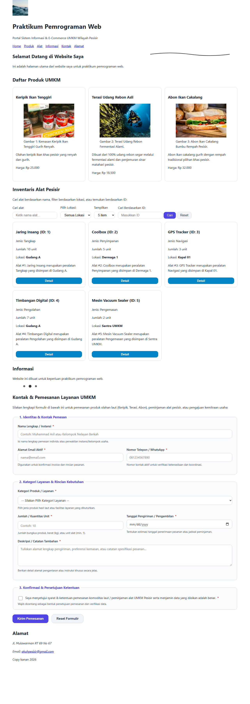
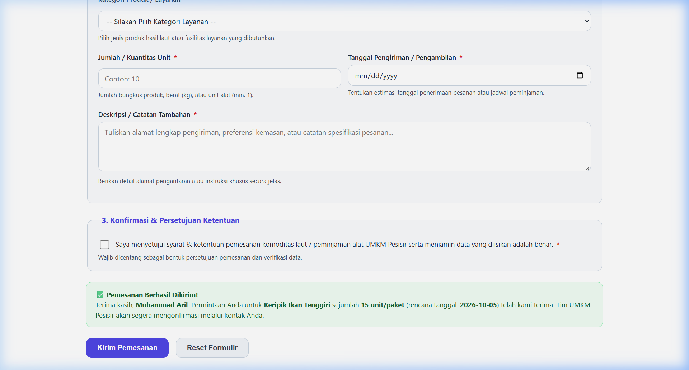

# Pemweb OBE - Sistem Informasi UMKM Pesisir

## 1. Identitas Proyek
- **Mata Kuliah:** Pemrograman Web (OBE)
- **Studi Kasus:** Sistem Informasi & E-Commerce UMKM Wilayah Pesisir (Technopreneurship Komoditas Hasil Laut)
- **Pendekatan:** Pengembangan Web Bertahap (Incremental Development)
- **Nama / NIM:** Muhammad Aril Saputra - 2440304029

---

## 2. Deskripsi Halaman
Proyek ini merupakan implementasi halaman landing page berbasis **HTML5 Semantik murni** yang dirancang sebagai pondasi awal (*Tahap 1: Staging Dasar HTML*) untuk ekosistem digital UMKM Pesisir. 

Halaman ini berfungsi sebagai portal informasi, etalase katalog produk olahan hasil laut (seperti Keripik Ikan Tenggiri dan Terasi Udang Rebon), serta sarana komunikasi/inquiry interaktif antara konsumen dan pelaku usaha pesisir. Struktur dokumen mematuhi standar aksesibilitas web (WCAG 2.1) dan hierarki heading terstruktur (`h1` &rarr; `h2` &rarr; `h3`).

---

## 3. Catatan Fitur & Daftar Tugas Selesai (Checklist)

- [x] **Struktur Semantik Standar W3C:** Menggunakan `<header>`, `<nav>`, `<main>`, `<section>`, `<article>`, `<figure>`, `<figcaption>`, `<address>`, dan `<footer>`.
- [x] **Hierarki Heading Teratur:** Memiliki satu `<h1>` utama, dilanjutkan dengan `<h2>` pada setiap seksi konten, dan `<h3>` pada setiap kartu artikel produk.
- [x] **Aksesibilitas Gambar (WCAG 2.1):** 
  - Gambar konten informatif dilengkapi atribut `alt` deskriptif.
  - Elemen gambar dekoratif dilengkapi atribut `alt=""` dan `role="presentation"` / `aria-hidden="true"`.
- [x] **Formulir Kontak Semantik:** Form input dilengkapi pasangan `<label for="...">` dan `<input id="...">` yang terhubung secara eksplisit.
- [x] **Aksesibilitas Navigasi Keyboard (WCAG 2.1 Focus State):** Seluruh tautan navigasi dan kontrol formulir memiliki *focus indicator* yang sangat jelas (`:focus-visible` ring warna Sky Blue dengan outline-offset 2px), tanpa jebakan fokus (*no keyboard trap*).
- [x] **Arsitektur CSS & Design Tokens (Tahap 2):**
  - Terhubung dengan `styles.css` eksternal dan Google Fonts `Plus Jakarta Sans`.
  - CSS Reset modern dan universal `box-sizing: border-box`.
  - Custom properties (`:root`) untuk token warna maritim pesisir, skala spacing 8-pt, dan border radius.
  - Navigasi responsif berbasis **Flexbox** dan kartu etalase produk berbasis **CSS Grid** (termasuk grid internal kartu).
  - *Content-driven media queries* teruji pada viewport **320px, 768px, 1024px, dan 1280px+ (desktop)** dengan zero-overflow (`overflow-x = 0`).
- [x] **Interaktivitas JavaScript (Tahap 3):**
  - Array inventaris peralatan pesisir (`daftarAlat` / `inventaris`).
  - Fitur pencarian alat real-time (`#search`) case-insensitive dengan pesan ramah jika tidak ditemukan.
  - Fitur filter lokasi dan pencarian ID alat.
  - **Tombol Detail & Event Delegation (Praktikum 2):** Tombol dinamis dengan atribut dataset `data-detail`, ditangani menggunakan *single event listener* pada container induk (`#daftar-alat`) melalui event delegation, serta menampilkan dialog semantik HTML5 (`<dialog id="modal-detail">`).
  - **Preferensi Limit Jumlah Item (Praktikum 3):** Dropdown pilihan batas item (5/10/20) yang disimpan ke `localStorage`, membaca preferensi tersimpan saat reload menggunakan operator `?? '5'`, dan merender item menggunakan `Array.slice()`.
- [x] **Formulir Utama Aksesibel (Accessible Form):**
  - Implementasi formulir pemesanan produk & peminjaman alat berbasis HTML5 semantik.
  - Memenuhi seluruh minimal field: Nama/judul, Email/kontak, Kategori/pilihan, Angka/tanggal, Deskripsi/catatan, dan Checkbox persetujuan.
  - Struktur terkelompok dengan `<fieldset>` dan `<legend>`.
  - Pasangan `<label for="...">` dan `id` eksplisit, teks bantuan terhubung via `aria-describedby`, serta `aria-required="true"`.
  - Desain responsif, mobile-friendly (touch target &ge; 44px), kontras WCAG 2.1 AA, dan live region alert (`role="status" aria-live="polite"`).

---

## 4. Formulir Utama (Accessible Form)

### A. Tujuan Formulir
Formulir utama pada seksi `#kontak` dirancang sebagai **Portal Pemesanan (Order) Komoditas Hasil Laut & Reservasi/Peminjaman (Booking) Peralatan Pesisir**. Tujuan utama formulir ini adalah:
1. **Pemesanan Produk Langsung (Direct Order):** Memfasilitasi pembeli/konsumen dalam memesan produk olahan laut UMKM (Keripik Ikan Tenggiri, Terasi Udang Rebon, Abon Ikan Cakalang, atau Paket Kombo) secara terstruktur.
2. **Peminjaman & Sewa Peralatan (Equipment Booking):** Membantu kelompok nelayan atau mitra pesisir dalam mengajukan peminjaman sarana operasional seperti coolbox penyimpanan ikan, jaring insang, dan mesin vacuum sealer.
3. **Kemitraan & Pengaduan Layanan:** Menyediakan saluran resmi untuk pengajuan kemitraan reseller/distributor maupun pelaporan kualitas produk/layanan.

### B. Spesifikasi Minimal Field (Checklist Ketentuan)

| No | Ketentuan Field | Elemen & ID Input | Tipe Input / Tag | Keterangan & Validasi |
|:--:|:----------------|:------------------|:-----------------|:----------------------|
| **1** | **Nama / Judul** | `#nama-pemesan` | `<input type="text">` | Wajib diisi (`required`), `autocomplete="name"`, terhubung dengan `#nama-hint`. |
| **2** | **Email / Kontak** | `#email-pemesan`<br>`#telepon-pemesan` | `<input type="email">`<br>`<input type="tel">` | Wajib diisi, validasi format email W3C, validasi pola nomor telepon (`pattern="[0-9+\s\-]{9,15}"`). |
| **3** | **Kategori / Pilihan** | `#kategori-layanan` | `<select>` + `<optgroup>` | Dropdown pilihan terstruktur (Pemesanan Produk, Peminjaman Alat, Kemitraan) dengan opsi default dinonaktifkan. |
| **4** | **Angka / Tanggal** | `#jumlah-pesanan`<br>`#tanggal-kebutuhan` | `<input type="number">`<br>`<input type="date">` | Input angka kuantitas (`min="1" max="1000"`) dan input tanggal rencana kebutuhan/pengiriman. |
| **5** | **Deskripsi / Catatan** | `#deskripsi-kebutuhan` | `<textarea rows="4">` | Kolom input multi-baris untuk rincian alamat pengiriman, permintaan kemasan, atau catatan spesifik. |
| **6** | **Checkbox Persetujuan** | `#persetujuan-syarat` | `<input type="checkbox">` | Checkbox wajib centang untuk konfirmasi komitmen pemesanan dan validitas data. |

### C. Catatan Aksesibilitas (WCAG 2.1 Compliance)
1. **Keterikatan Eksplisit Label (`Explicit Label Association`):**
   Seluruh kontrol input, select, textarea, dan checkbox dipasangkan secara eksplisit menggunakan atribut `<label for="[id]">` yang merujuk langsung ke `id` elemen kontrol. Tidak ada kontrol input yang berdiri tanpa label.
2. **Pengelompokan Semantik (`<fieldset>` & `<legend>`):**
   Formulir dibagi menjadi 3 bagian logis untuk membantu pengguna pembaca layar (*screen reader*) memahami konteks form tanpa disorientasi:
   - *1. Identitas & Kontak Pemesan*
   - *2. Kategori Layanan & Rincian Kebutuhan*
   - *3. Konfirmasi & Persetujuan Ketentuan*
3. **Penyambungan Teks Bantuan (`aria-describedby`):**
   Setiap kolom input dilengkapi dengan `<small class="form-hint" id="...">` yang ditautkan ke input melalui atribut `aria-describedby`. Pembaca layar akan otomatis membacakan instruksi bantuan saat input mendapatkan fokus.
4. **Indikator Wajib Aksesibel (`Accessible Required Attributes`):**
   Kolom wajib ditandai secara visual dengan bintang merah `<span class="required-mark" aria-hidden="true">*</span>` dan secara semantik mesin dengan atribut `required` serta `aria-required="true"`.
5. **Indikator Fokus Kontras Tinggi (`:focus-visible`):**
   Seluruh input, select, textarea, dan button memiliki ring outline fokus tegas (`3px solid #111` dengan `outline-offset: 3px`) saat dinavigasi menggunakan keyboard (`Tab` / `Shift+Tab`), tanpa menghilangkan outline default sebelum ada interaksi.
6. **Ukuran Target Sentuh Mobile (WCAG 2.5.5 Target Size):**
   Seluruh elemen input dan tombol aksi dirancang dengan tinggi area sentuh minimal **44px** (`min-height: 44px`), menjamin kemudahan aksesibilitas pada perangkat layar sentuh (*mobile touch screens*).
7. **Umpan Balik Live Status (`role="status"` & `aria-live="polite"`):**
   Container notifikasi keberhasilan pengiriman formulir menggunakan `role="status"` dan `aria-live="polite"` sehingga pesan konfirmasi dibacakan oleh pembaca layar segera setelah proses validasi berhasil tanpa menginterupsi pengguna.
8. **Rasio Kontras Warna (WCAG 2.1 AA/AAA):**
   Warna teks (#1f2937), teks bantuan (#4b5563), tombol brand (#4f46e5 dengan teks #ffffff), dan alert status memenuhi rasio kontras minimal 4.5:1 terhadap latar belakang.

### D. Bukti Tangkapan Layar (Localhost)
- Bukti tampilan formulir lengkap & responsif di localhost:  
  
- Bukti interaksi pengiriman dan notifikasi sukses (`role="status"`):  
  

---

## 5. Panduan Menjalankan Proyek (Laragon 5)

1. **Lokasi Direktori:**
   Pastikan folder repositori ini diletakkan pada direktori root web Laragon:
   ```text
   C:\laragon\www\pemweb-obe
   ```

2. **Menjalankan Server Lokal:**
   - Buka aplikasi **Laragon 5**.
   - Klik tombol **Start All** untuk menyalakan modul Apache dan MySQL.

3. **Mengakses Halaman Web:**
   Buka peramban web (Google Chrome / Mozilla Firefox / Microsoft Edge) dan akses URL berikut:
   - `http://localhost/pemweb-obe`
   - atau melalui virtual host Laragon: `http://pemweb-obe.test`

---

## 6. Audit & Log Penggunaan AI (AI Usage Governance)
Proses pengerjaan dan refaktorisasi kode pada modul ini didokumentasikan secara transparan sesuai kaidah integritas akademik RPS OBE. Rincian prompt, verifikasi arsitektur, dan justifikasi teknis dicatat secara berkala pada file:
👉 **[AI_USAGE_LOG.md](AI_USAGE_LOG.md)**
